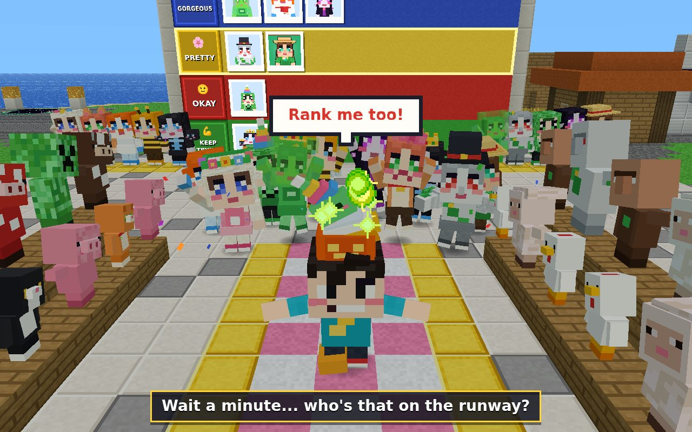

# Mob Beauty Pageant

**▶ Play now: https://kunruiw1991.github.io/mob-beauty-pageant/** (iPad / phone / desktop — touch first, no install)

A kid-friendly, silly voxel 3D browser game inspired by the Bilibili video
[BV1XynB6EEpk](https://www.bilibili.com/video/BV1XynB6EEpk) ("Minecraft: Mob Beauty Ranking! An Online Beauty
Pageant!"). Explore a compact blocky island, finish a short tactile mini-quest to meet each Minecraft-style mob
contestant, dress her up on the runway, snap a polaroid, and **drag her portrait onto the giant 5-row tier wall** —
while the rival **Kai** keeps getting in the way (and keeps losing, hilariously). Everyone talks: every contestant,
Kai, Bella and the narrator have their own recorded voice, with big English subtitles.

Every row is a happy row: 👑 PERFECT · 💎 GORGEOUS · 🌸 PRETTY · 🙂 OKAY · 💪 KEEP TRYING — contestants always react
with joy or a funny dance, and the crowd of pigs, chickens, cows, villagers and creepers cheers along. Humor comes
from the quests and the rival, never from looks.

## How to play

| Action | Touch / mouse |
|---|---|
| Walk | Tap the ground (or anything — you walk to it) |
| Interact | Tap the glowing thing / the contestant (you walk over first) |
| Look around | Drag on the world with one finger |
| Find the next contestant | Follow the light beacon, or tap the edge arrow with her face |
| Rank | Drag the polaroid onto a row (or tap the card, then a row) |
| Leaderboard / pause | 🏆 chip top-left · ⏸ top-right |
| Music / sounds / voice | ⏸ → 🎵 Music · 🔔 Sounds · 🔊 Voice (the voice setting is remembered) |

≤ 4 buttons on screen while playing, all ≥ 68 px. No text walls: icons, beacons, picture hints and short spoken
lines (with subtitles) show the way. Progress (board, portraits, stars) is saved in the browser
(`pageant_progress`). A full run takes about 12–20 minutes.

**Stars:** ★ rank all 10 contestants · ★ find both hidden contestants · ★ finish within 20 minutes.

## Contestants

| # | Contestant | Mob | Quest | Gag |
|---|---|---|---|---|
| 1 | Blossom | Sheep | Pick 5 sparkly flowers from the trail she grows, hand her the bouquet | She eats the bouquet and sneezes petals |
| 2 | Bobo | Slime | Bop her bouncing slimes (big ones split) | Kai gets bounced into the pond; a tiny slime moves onto her head |
| 3 | Mimi | Cat | Sneak through the jungle while she isn't looking, offer a fish | Her "gift" is Kai's stolen hat |
| 4 | Tinny | Iron Golem | Mine iron, "borrow" blocks from Bella's statue, get a pumpkin, build the T | Fake-iron dirt swap (Bella 💢), Kai hogs the pumpkins, a snow golem's head pops off |
| 5 | Snowy | Snow Golem | Snowball fight against Kai behind his snow wall | Kai ends up as a snowman |
| 6 | Hissy | Creeper | Calm her fuse with well-timed pats | Her happy explosion is pure confetti |
| 7 | Buzzy | Bee | Simon-says: tap the flowers in the order she visits them | Kai gets stuck on a honey block |
| 8 | Endie | Enderman | Free her in the End — Kai steals her — cross his lava-ring prison with a cake decoy | Kai ends up locked in his own cell with cake on his face |
| 9 | Trio | Wither | Pop skull helmets off wither skeletons in the Nether, dig soul sand, build the T | Bald skeletons run off blushing; her 3 heads want 3 hats |
| 10 | Emma | Villager | Get "rich": trades, Mr. Question's dropped diamonds, crack Kai Bank's passcode chest | Her eyes turn into emeralds; Kai faints at his empty chest |
| H1 | Baby Dragon | Ender Dragon (hidden) | Chase the teleporting dragon egg in the End | The egg hops away every time |
| H2 | Pinky | Pink Sheep (hidden) | Find the pink tulip, give it to the one white sheep | Pink puff — and Bella claims her |
| ★ | Kai | Rival | Finale: struts the runway in all his junk and demands to be ranked | Push-ups on KEEP TRYING, happy tears on PERFECT |

## World

One ~80×80 hub island — plaza with the tier wall, runway, mob bleachers and red-caped "?" mystery figures (they
flip to reveal each contestant), flower meadow, swamp, iron cave, village with Bella's statue and Kai Bank, snowy
pocket, jungle, Kai's prismarine house and lava-ring prison — plus End and Nether pockets reached through portals.
You are Chen, in the green creeper hoodie.

## Voice-over

88 short recorded lines (1.4 MB, `assets/voice/*.mp3`): a welcome, every contestant's hello + quest hint +
thank-you cheer, tier-row reactions, Kai's slapstick complaints and his finale "Rank me!", Bella, Mr. Question and
the narrator ("Strike a pose!", "Drag her picture to a row!"). One voice at a time, the music ducks while someone
talks, and the line appears as a big subtitle. Lines are generated with neural text-to-speech voices by
`tools/gen_voice.py`, which holds the whole script — edit a line there and re-run it (needs `edge-tts` + `ffmpeg`)
to regenerate the clips and `src/data/voice_lines.js`. The game never uses in-browser speech synthesis.

## Tech

- Zero-build ES2022 modules + vendored Three.js r170; all 16×16 block textures, mob skins, accessories, music and
  sound effects are generated procedurally in code (canvas + WebAudio). The only asset files are the voice clips.
  No CDN.
- Chunked voxel meshes with hidden-face culling, baked vertex AO, one atlas material, a terrain "cutaway" shader so
  trees never hide the player, A* tap-to-walk on the voxel grid (6.5 blocks/s, 7.8 on long trips, with smooth turns
  and rounded corners), instanced crowd and particle pools.
- Fixed-timestep 60 Hz deterministic simulation (rendered with sub-step interpolation) and a frozen
  `window.__PAGEANT__` test seam (`startGame`, `teleport`, `completeQuest`, `rank`, `stepFrames`, `getState`,
  `voiceInfo`, …).
- All text lives in `src/data/strings.js` / `src/data/roster.js`.
- Tests (headless Chrome over CDP): `python3 tests/smoke.py`, `python3 tests/run_e2e.py` (42 checks, incl. walking
  speed, voice clips/playback/subtitles/toggle and an English-only DOM + canvas audit),
  `python3 tests/layout_audit.py` (1280×800, 1024×768, 844×390, 390×844), `python3 tests/sim_gates.py`
  (14 fun gates over 20 seeds: first contact, quest completability, zero dead taps, a gag per quest, touch drag on the
  board, performance, session length, determinism, persistence…). Set `PAGEANT_TMP` to choose the scratch folder.

See [docs/DESIGN.md](docs/DESIGN.md) for the full design and the fun gates (§12 covers v1.1).

## Changelog

- **v1.1 — faster walking, English, voice-over.** Walking is 1.5× faster (6.5 blocks/s, 7.8 on long trips) with
  leg cadence matched to speed, smooth turning, rounded corners, a tighter follow camera and judder-free rendering;
  the whole game is in English (new names: Blossom, Bobo, Mimi, Tinny, Snowy, Hissy, Buzzy, Endie, Trio, Emma, Baby
  Dragon, Pinky; Chen, Kai, Bella, Mr. Question); 88 recorded voice lines with subtitles and a Voice on/off switch in
  the pause menu.
- **v1.0** — 10 contestants + 2 hidden + rival finale; 10 tactile quests (24 gags with a gag camera); End + Nether;
  runway dress-up with 16 voxel accessories and polaroid portraits; drag-to-rank tier wall mirrored in 3D; final
  leaderboard with stars and PNG sharing; MC-mob crowd; procedural music and SFX; iPad/phone layouts.

Fan-made tribute for family fun; not affiliated with Mojang/Microsoft or the video's creator.
